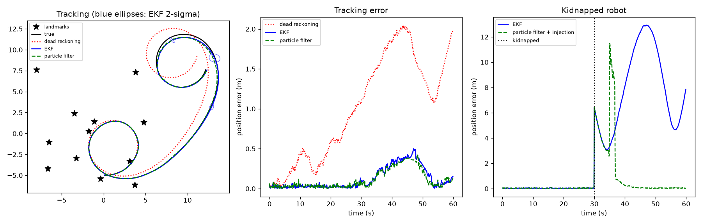

# Mobile Robot Localization: EKF vs. Particle Filter

A differential-drive robot drives loops in a 20 m x 20 m field with 12 known landmarks. It has noisy wheel odometry and a range-bearing sensor (6 m range, 10 cm / 2 degree noise). Three estimators run side by side:

- **Dead reckoning:** integrates the wheel commands only.
- **Extended Kalman filter:** linearized unicycle motion model, range-bearing measurement model, and a chi-square gate to reject outliers.
- **Particle filter (Monte Carlo localization):** 500 particles, low-variance resampling when the effective sample size drops, and Augmented-MCL random particle injection when the measurements stop matching.



## Run

```bash
python3.11 -m venv .venv && source .venv/bin/activate
pip install -r requirements.txt
python localization.py
python localization.py --seed 3 --particles 1000
```

## Experiments

1. **Tracking:** position and heading RMSE over 10 runs of 60 s, plus compute time per step.
2. **Kidnapped robot:** at t = 30 s the robot is picked up, moved about 6.4 m and turned 90 degrees, and nobody tells the filters. "Recovered" means position error stays under 0.5 m for 2 s.

## Results

<!-- paste your output here -->

## What I learned

- The EKF is the most accurate and cheapest when its starting guess is good, but it cannot recover from a kidnapping: its outlier gate rejects every measurement that disagrees with its belief.
- The particle filter can represent many hypotheses at once, so random injection lets it find the robot again.
- Errors grow for every method where landmarks are sparse.

## Limitations

- Known data association (each measurement comes with its landmark ID).
- 2-D world with point landmarks; no map building (that would be SLAM).
